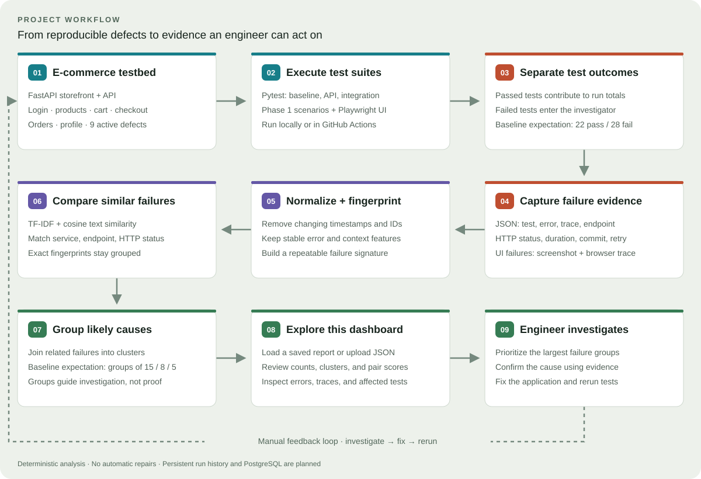

# AI Test Failure Investigator

A deliberately buggy e-commerce testbed and a small deterministic investigator. The app has login, product search, products, cart, checkout, orders, and profile workflows. The failures are intentional; this is a test target, not production software.

## Project workflow



The dashboard presents an animated canvas of connected, colored workflow boxes with curved arrows, a pass/fail branch, moving progress dots, and a manual feedback loop. It includes play/pause, replay, clickable steps, and speed controls. It illustrates expected baseline behavior rather than live execution. The full selected-report flowchart is available in an expander. The dashed feedback loop represents an engineer investigating, fixing, and rerunning tests.

## Run the experiment

```sh
python -m pip install -e ".[dev]"
python run_demo.py
```

`run_demo.py` runs the original 50-execution benchmark in `tests/test_milestone.py`. Pytest reports 28 intentional failures and 22 passes; the runner exits successfully only when those failures cluster into groups of 15, 8, and 5. The JSON artifact is written to `artifacts/failures.json`.

To inspect the raw failing pytest output and artifact directly:

```sh
python -m pytest -q
python -m investigator.analyze artifacts/failures.json
```

The full suite also includes `tests/test_phase1.py`, which covers healthy workflows and six active additional injected defects and one fixed defect. It therefore fails by design. Use `python -m pytest -q tests/test_phase1.py --tb=no` to run just those Phase 1 scenarios.

## Test layers

- API contract matrix: 100 parameterized executions, including 11 expected defect failures.
- Integration workflows: 20 executions across login, search, cart, checkout, and order history.
- Browser UI: five Playwright tests run against a locally spawned Uvicorn server, including one expected locator-defect failure.
- Phase 1 defect suite: 10 executions with six expected failures.

Run each layer locally:

```sh
python -m investigator.validate_suite --expected-tests 100 --expected-failures 11 --artifact artifacts/api.json tests/api
python -m investigator.validate_suite --expected-tests 20 --expected-failures 0 --artifact artifacts/integration.json tests/integration
python -m playwright install chromium
python -m investigator.validate_suite --expected-tests 5 --expected-failures 1 --artifact artifacts/ui.json tests/ui
```

GitHub Actions installs Chromium, validates each layer's expected counts, and uploads JSON failure records plus any browser screenshots and trace ZIPs. For each failed UI test, the record includes its browser, screenshot path, trace path, and failed network requests. The API container has a health check for local Docker runs.

## Failure dashboard

Install the optional dashboard dependencies and launch Streamlit:

```sh
python -m pip install -e ".[dashboard]"
streamlit run app/dashboard.py
```

The dashboard opens with a plain-language project overview, the application/investigator/outcome story, and an expandable guide to test coverage, architecture, implemented capabilities, and planned work. Selected-run results are distinguished from expected benchmark counts, and clusters are presented as likely causes for investigation.

The dashboard reads saved JSON reports from `artifacts/`. Click **Run 50-test demo** in the main panel to execute the actual pytest benchmark. The retained workflow walkthrough reports each step with its measured result: execute tests, capture the structured artifact, normalize failures into fingerprints, compare candidate pairs with TF-IDF/cosine, then group root causes. It verifies the benchmark result of 50 tests, 28 failures, and three clusters. The five-stage walkthrough is saved into `artifacts/failures.json`, so it remains visible after a page refresh or in a new dashboard session. The evidence view shows a raw-to-normalized example, the resulting fingerprint, actual cosine scores for representative failure pairs, and per-test details. The clusterer uses a default 0.35 cosine-similarity threshold and only joins failures that share service, endpoint, and HTTP status. Adjust the threshold in the sidebar to explore broader or narrower groupings. Exact fingerprints remain grouped.

Clustering regression tests are in `tests/test_clustering.py`; the core 50-case run verifies the expected 15/8/5 clusters.

## Intentional defects

- `BUG-01`: certain coupon codes make checkout return HTTP 500 (15 failing cases).
- `BUG-02`: expired bearer tokens are accepted (8 failing cases).
- `BUG-03`: cart totals above quantity five omit one item (5 failing cases).
- `BUG-04` (fixed): `DOUBLE5` now applies one $5 discount; regression tests cover both coupons and totals below the discount.
- `BUG-05`: an authenticated user can fetch another user's order by ID.
- `BUG-06`: search queries beginning with `slow-` pause for 250 ms.
- `BUG-07`: `/?locator_bug=true` changes the checkout button's `data-testid`.
- `BUG-08`: `?schema_drift=true` renames product `price_cents` to `price`.
- `BUG-09`: concurrent checkout retries can create multiple orders for one idempotency key.
- `BUG-10`: `?delayed=true` adds 600 ms to product search responses.

BUG-06, BUG-07, BUG-08, and BUG-10 have explicit query switches so each defect is reproducible without making every ordinary request flaky. The other 22 baseline executions cover healthy API paths and noise normalization. Failure collection records test identity, stack trace, endpoint, observed status when available, duration, commit, retry, and browser artifacts when a UI test fails.

## API and container

Run locally with `uvicorn app.main:app --reload`, or use `docker compose up --build`. The storefront and API listen on port 8000. Test data is intentionally in-memory; persistent run history and PostgreSQL are later milestones.

## SDET quality gate and regression example

CI runs six independent jobs (core, baseline, Phase 1, API, integration, browser), with evidence uploaded even when a job fails. Layer validators check each test's declared outcome as well as totals and pytest exit status. A healthy test failure, an unexpected pass of a known defect, a skip, or a setup/teardown failure rejects the run. Known defects are declared with `failure_context(bug_id=...)`; this checks expected failing test identities, not an exact error signature.

BUG-04 is the first fixed defect: `DOUBLE5` used to subtract $10 instead of $5. Regression coverage checks both five-dollar coupons at $25, $5, and $2 subtotals, including a zero floor. Phase 1 now expects six failures instead of seven; the original 50-case benchmark remains 28 failures in groups of 15/8/5.

```sh
python -m pytest -q tests/test_quality_gate.py tests/test_clustering.py tests/regression
python -m investigator.validate_suite --expected-tests 10 --expected-failures 6 --artifact artifacts/phase1.json tests/test_phase1.py
```

See [the bug-fix case study](docs/bug-fix-case-study.md). Branch protection must be configured in GitHub to require these CI checks before merging.
